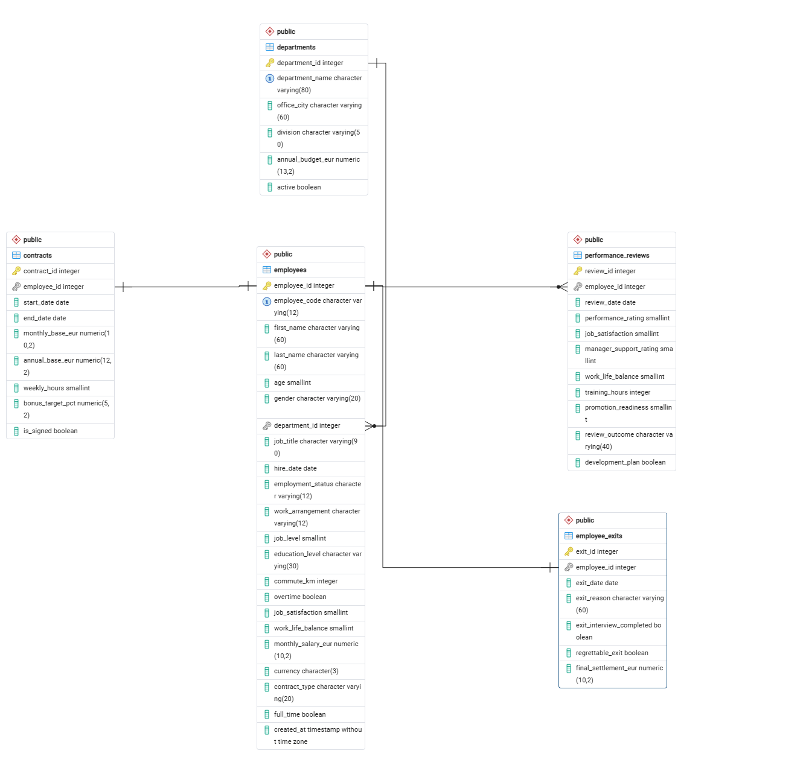

> **DATA TRANSPARENCY — AI-SYNTHESIZED DATA**  
> All five datasets in this repository contain fictional, AI-generated synthetic HR records. They are **not real employee or company data**. All metrics and dashboard insights are illustrative and must not be interpreted as findings about a real organization.

# HR Retention & Workforce Risk Analysis

**PostgreSQL 18 | pgAdmin 4 | SQL | Power BI Desktop | DAX | HR Analytics**

An end-to-end HR analytics portfolio project combining relational database design, SQL analysis, and a **two-page interactive Power BI report**. The project uses original, **synthetic** workforce records to explore patterns associated with employee exits. It was developed as an individual academic SQL assignment and expanded into a business intelligence case study.

> **Business question:** How do employee exits vary across departments, overtime status, job satisfaction, work-life balance, and compensation?

## At a glance

| Indicator | Result |
|---|---:|
| Employees | 900 |
| Recorded exits | 156 |
| No recorded exit | 744 |
| Historical exit proportion | 17.33% |
| Departments | 8 |
| Performance reviews | 1,802 |

The 17.33% measure is the share of records with an exit, **not an annualized turnover rate**.

## Power BI dashboards

The editable report, [`HR_Retention_Analytics.pbix`](powerbi/HR_Retention_Analytics.pbix), contains **two pages**:

### 1. Retention Analytics

- KPI cards: total employees, exited employees, historical attrition %, employees without a recorded exit
- Department-level exit proportion bar chart
- Employee exit distribution donut chart
- Interactive slicers for overtime, gender, and department


### 2. Workforce Risk Drivers

- Overtime vs. attrition
- Job satisfaction vs. attrition
- Average monthly salary by exit status
- Work-life balance vs. attrition
- Interactive workforce filters


Both screenshots are taken from the author’s project evidence document. The editable report is in the `.pbix` file.

See [Power BI documentation](powerbi/README.md) for measures and usage.

## SQL analysis: selected findings

| Segment | Exits / employees | Exit proportion |
|---|---:|---:|
| Field Services | 18 / 76 | 23.68% |
| People & Culture | 7 / 71 | 9.86% |
| Overtime = Yes | 73 / 275 | 26.55% |
| Overtime = No | 83 / 625 | 13.28% |
| Job satisfaction = 1 | 37 / 102 | 36.27% |
| Job satisfaction = 4 | 28 / 254 | 11.02% |

Average monthly salary was **€5,392.81** for exited employees and **€5,384.65** for employees without a recorded exit. These are descriptive comparisons in synthetic data, not causal conclusions.

## Relational database

Five tables model HR operations: `departments`, `employees`, `contracts`, `performance_reviews`, and `employee_exits`. Foreign keys link employees to their departments, contracts, reviews, and exits. The `public.vw_employee_retention` SQL view combines employee, department, contract, and exit records for one-row-per-employee analysis.



The SQL files demonstrate DDL, foreign keys, joins, a reusable view, grouping/aggregation, and CREATE/READ/UPDATE/DELETE operations.

## Repository structure

```text
.
├── README.md
├── data/                       # Five synthetic CSV datasets
├── diagrams/
│   └── HR_Retention_Physical_ERD.png
├── sql/
│   ├── 01_schema.sql
│   ├── 02_import_order.txt
│   ├── 03_join_view.sql
│   ├── 04_analytics.sql
│   └── 05_crud.sql
├── powerbi/
│   ├── HR_Retention_Analytics.pbix
│   ├── README.md
│   └── screenshots/
│       ├── retention_overview.png
│       └── workforce_risk_drivers.png
```

## Reproduce the project

1. Install PostgreSQL and pgAdmin 4; create a **new** database called `hr_retention_analysis`.
2. Execute [`sql/01_schema.sql`](sql/01_schema.sql) in the new database. **Warning:** it drops and recreates project tables.
3. Import the five CSV files in the order documented in [`sql/02_import_order.txt`](sql/02_import_order.txt).
4. Execute [`sql/03_join_view.sql`](sql/03_join_view.sql) to create the analytical view.
5. Execute [`sql/04_analytics.sql`](sql/04_analytics.sql) to reproduce the analytical findings.
6. Use [`sql/05_crud.sql`](sql/05_crud.sql) to demonstrate CRUD safely in a test transaction.
7. Open the `.pbix` in Power BI Desktop. If the PostgreSQL connection points to a different machine or instance, update the data source under **Transform data → Data source settings**, then refresh. Power BI Desktop and a local PostgreSQL instance are required for live refresh.

## Academic submission

The university Mid-Term report and original screenshot evidence are intentionally excluded from this public portfolio to protect student identification details and document metadata.

## Data provenance and limitations

- Dataset: AI-generated, fictional employee records, not actual personnel data or a Kaggle dataset.
- Source project notes: random seed `10231`, snapshot reference `2026-10-01`.
- Observational patterns do not prove that overtime, salary, or satisfaction causes employees to leave.
- Results are not representative of any real organization and should not be used for personnel decisions.
- Do not publish PostgreSQL passwords or connection secrets.

## Skills demonstrated

**Data modeling:** relational schema, primary/foreign keys, ERD, constraints  
**SQL:** joins, views, aggregation, filtering, CRUD, data validation  
**BI:** Power BI, DAX measures, interactive slicers, KPI design  
**Business interpretation:** HR retention analysis, communication of limitations and findings

---

*Portfolio project: HR domain expertise combined with hands-on SQL and business intelligence skills.*
